# FGC Open Scorebars — Broadcast Suite for the FGC

[](LICENSE)
[](https://nodejs.org/)
[](https://obsproject.com/)
[](#tournament-integration-startgg--challonge)
[](#key-highlights)
[](https://ko-fi.com/nordi5ke)

A **100% free, open-source, zero-dependency** local OBS broadcast suite crafted for the Fighting Game Community (FGC) — starting with **Tekken 8** and **Street Fighter 6** and actively expanding to more fighting games.

Built on pure HTML/CSS/JS and a lightweight native Node.js HTTP/SSE server — **no cloud accounts, no paywalls, no subscriptions, no Electron bloat, and no `npm install` required**.

<p align="center">
  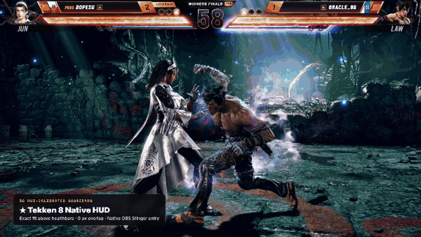
</p>

---

## Visual Showcase & Live Demos

### 1. Live Broadcast Scorebars (56 HUD-Calibrated Designs)

<p align="center">
  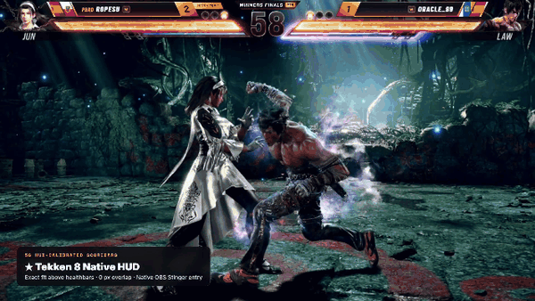
</p>

| Tekken 8 Native HUD (0 px Overlap) | TWT 2026 Blade · Flag Fade Studio |
| :---: | :---: |
| 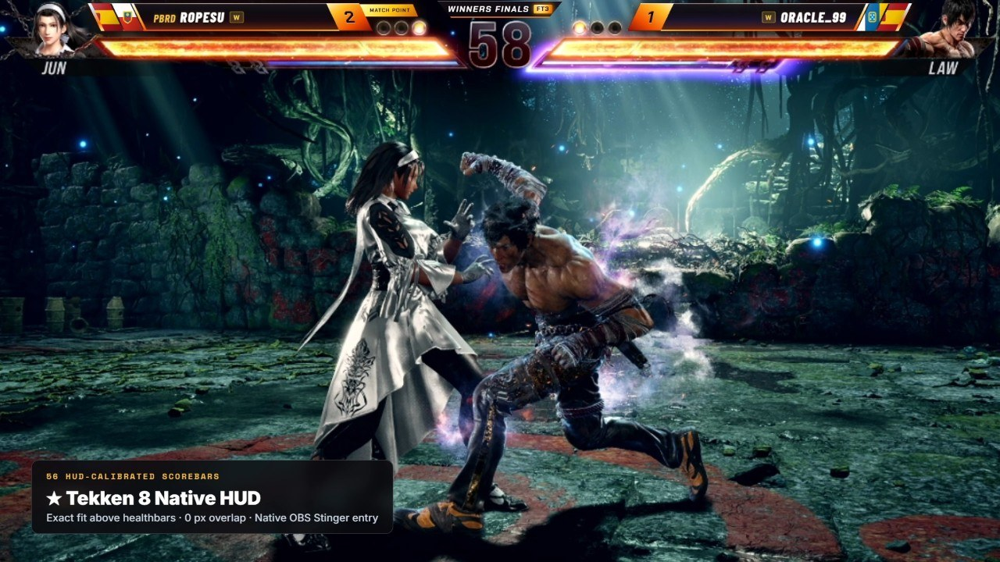 | 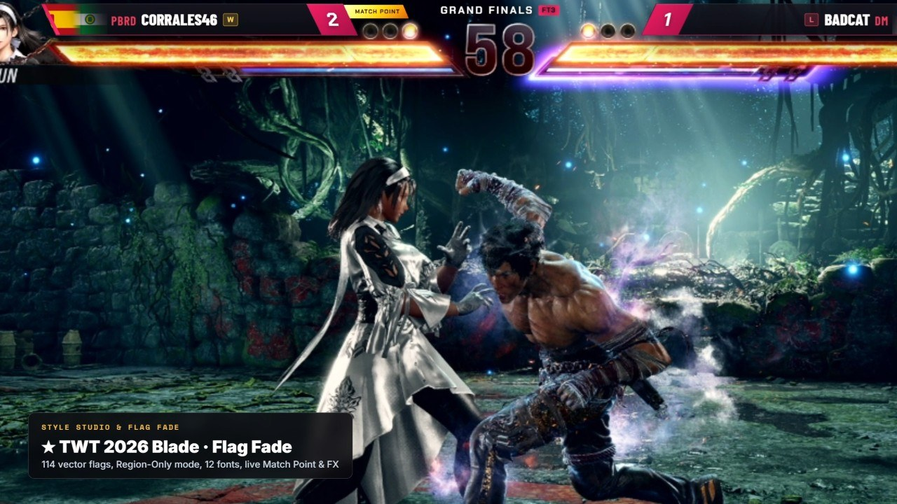 |
| **SF6 Native Drive HUD** | **SF6 Broadcast White Studio** |
| 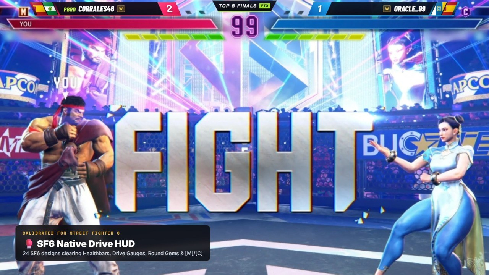 | 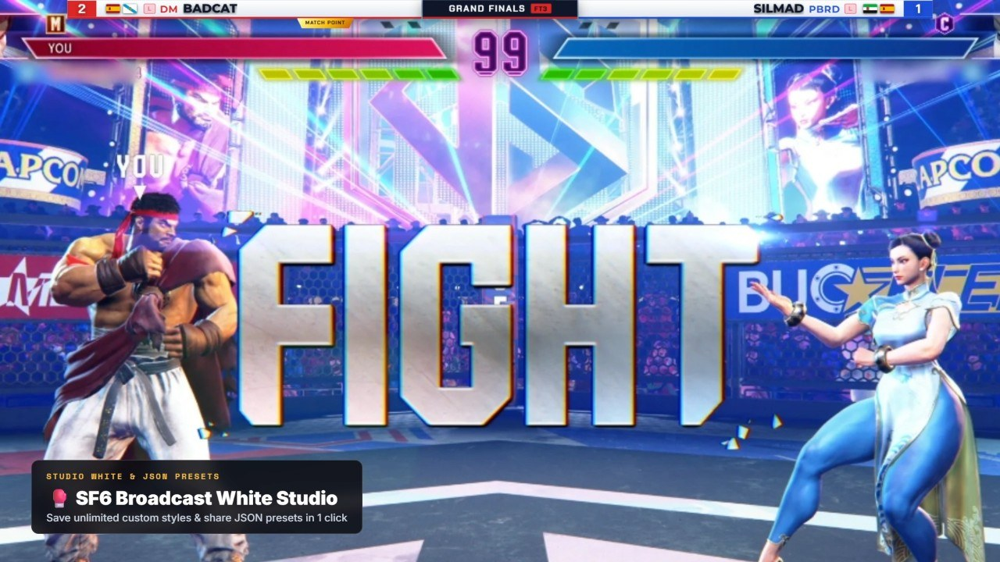 |

### 2. Interactive Full-Screen VS Splash (42 Designs · 240+ Game Packs)

<p align="center">
  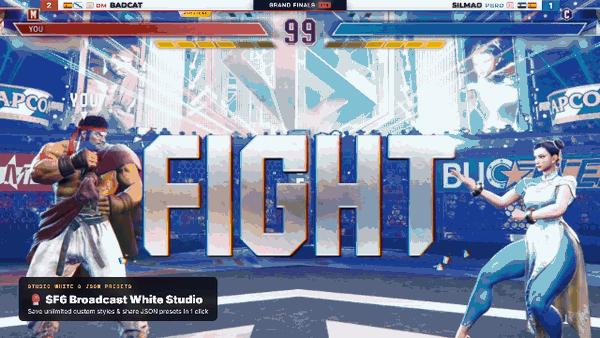
</p>

| Mishima EWGF (Animated Vertical Divider) | Tekken 8 Clash | Arcade Pop |
| :---: | :---: | :---: |
| 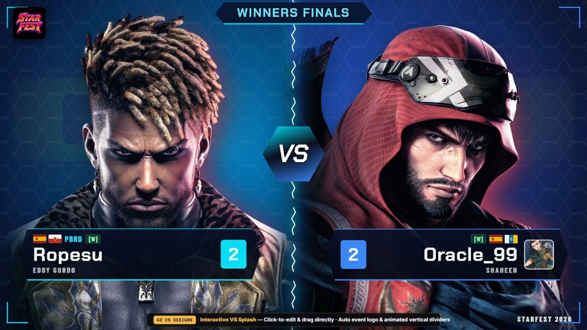 | 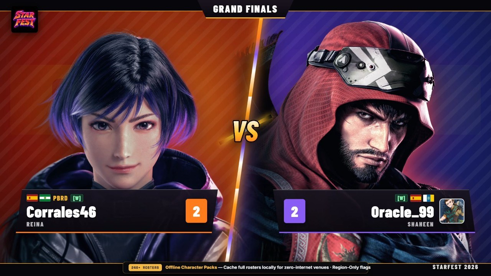 | 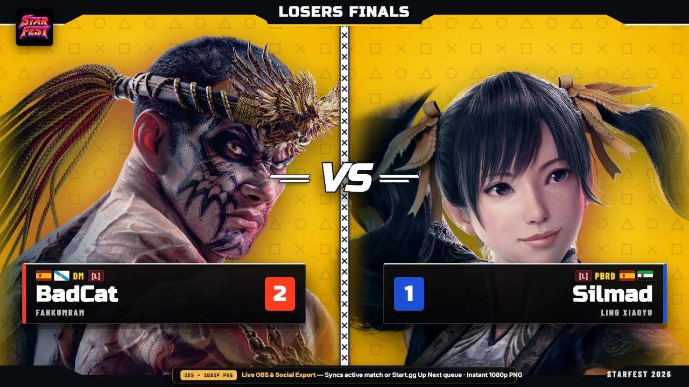 |

### 3. Tournament Final Results & Podiums (24 Designs · 6 Pro Layouts · 1080p PNG Export)

<p align="center">
  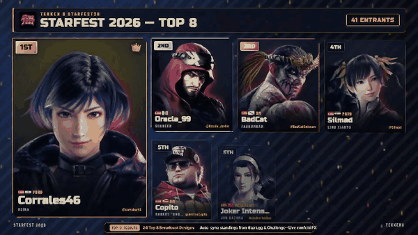
</p>

| Champion Left Top 8 (`EVO Gold`) | Grand Top 3 Podium | Champion Spotlight + 8-Row Ladder |
| :---: | :---: | :---: |
| 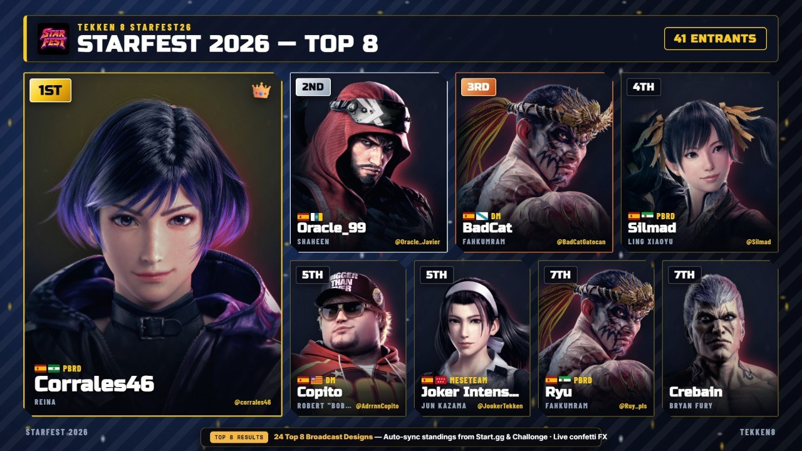 | 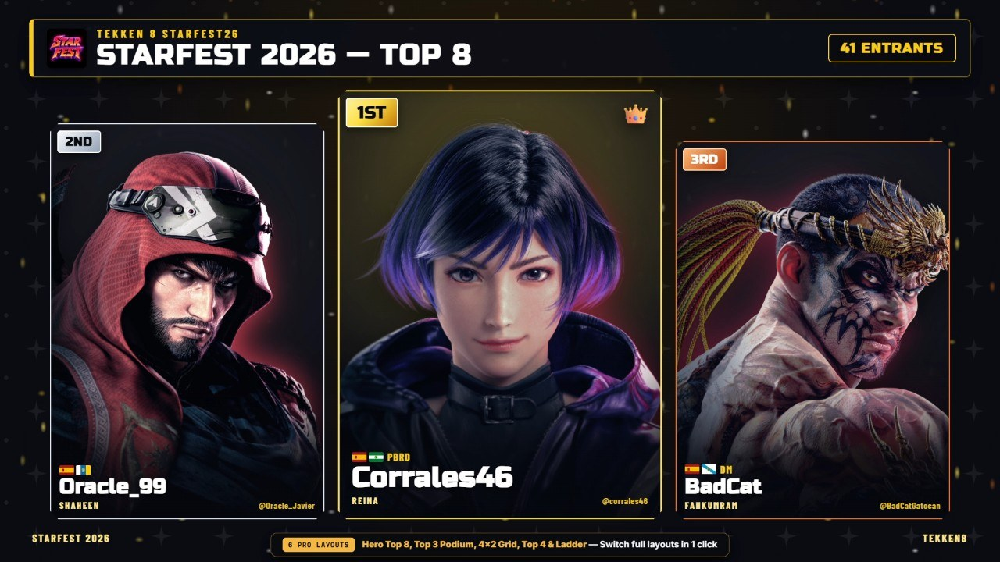 | 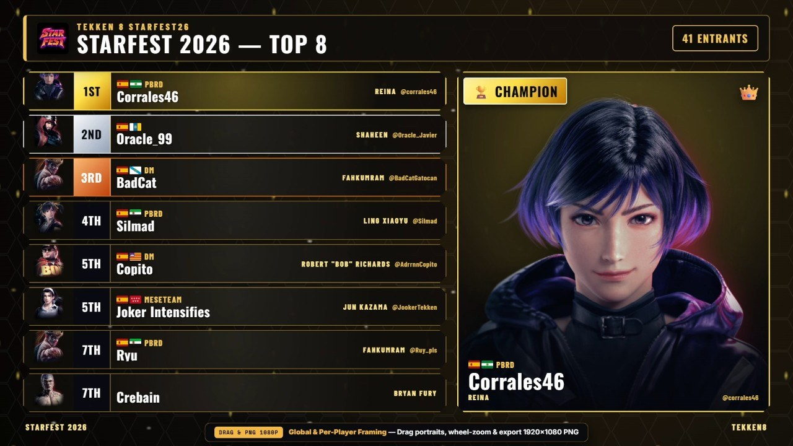 |

---

## Key Highlights

- **56 Broadcast Scorebar Designs** calibrated around **Tekken 8** (32 designs) and **Street Fighter 6** (24 designs in `sf6-themes.js` engineered with pixel-verified clearance around SF6 healthbars, Drive Gauges, Control Type badges, and Round Win diamonds) — built to expand across more fighting games.
- **42 Full-Screen VS / "Up Next" Match Splash Designs (`vs.html` & `vs-designs.js`)** with **Click-to-Edit**, direct canvas drag-to-reposition, animated scrolling center dividers, 10 VS emblem architectures, 10 entry choreographies, automatic official tournament logo loading, region-only flag option, **240+ fighting game character packs** (`StreamHelperAssets`), and **1920×1080 PNG export**.
- **24 Tournament Final Results Designs (`results.html` & `results-designs.js`)** across 6 layouts (**Champion Left Top 8**, **Elevated Top 3 Podium + 4th–8th**, **4×2 Esports Grid**, **Champion Spotlight + 8-Row Ladder**, **Top 4 Towers**, and **Grand Top 3 Podium**), 10 staggered entry choreographies, 8 ambient FX, global + per-player direct drag/wheel portrait framing, automatic live/final standings sync from Start.gg & Challonge, and **1920×1080 PNG social graphic export**.
- **Adaptive Colors, Surfaces & Dedicated Flag Fade Studio** with 5 surface modes (**Gradient**, **Solid**, **Frosted Glass**, **Metallic**, **Theme BG**), **38 1-click palettes**, and **114 Offline Vector Flags (`flags.js`)** (World FGC, Europe & Regions, US States, Spain Regions).
- **Native Start.gg (GraphQL v4) & Challonge (API v1) Integration** with privacy-first local token handling (RAM-only by default, zero token characters exposed in the UI, 1-click **Clear Token**), Stream Queue, entrant & avatar import, side-swap-aware result reporting, **Match History & H2H**, and offline **Demo Tournament** mode.
- **Bilingual Control Panel (`EN | ES`) + OBS Native Scene Transitions + Instant Offline QR Mobile/Tablet LAN Remote + OBS Custom Dock** (`<= 1320px` responsive layout).

---

## Quick Start

> **Clean fresh install out of the box:** this repository contains **no preloaded API tokens, no personal players, and no match history**. On first launch, `server.mjs` automatically creates a fresh local `data/` directory on your machine (gitignored).

### Requirements
- **Node.js 18+** (recommended Node.js 20 / 22 / 24 LTS). **Zero npm packages required.**

### Windows (1-Click Launch)
1. Double-click **`Start_Scorebar.bat`**.
   - If Node.js is not installed on the PC, the launcher automatically offers to run **`Install_NodeJS.bat`** (uses `winget` with an automatic direct MSI fallback from `nodejs.org`).
   - You can also run **`Install_NodeJS.bat`** directly beforehand on any fresh tournament PC.
2. Your browser opens the Control Panel at `http://localhost:8787/panel.html`.
3. Keep the terminal window open during your broadcast.

### macOS / Linux / Terminal
```bash
node server.mjs
```
- **Scorebar Overlay URL (OBS Browser Source):** `http://localhost:8787/`
- **VS Match Splash URL (OBS Browser Source):** `http://localhost:8787/vs.html`
- **Tournament Results URL (OBS Browser Source):** `http://localhost:8787/results.html`
- **Control Panel URL:** `http://localhost:8787/panel.html`

> You can customize the port with `PORT=9090 node server.mjs`.

---

## OBS Studio Setup

### 1. Add the Overlay (`Browser Source`)
1. In OBS Studio, add a **Browser** source.
2. Set **URL** to `http://localhost:8787/` (or `/vs.html` / `/results.html`).
3. Set **Width** to `1920` and **Height** to `1080`.
4. Leave **Custom CSS** empty.
5. **Recommended for zero-flicker automatic scene transitions:**
   - Uncheck *"Refresh browser when scene becomes active"*.
   - Set **Page permissions** to *"Read access to OBS status information"*.
   - In the Control Panel under **Style Studio → FX & Transitions**, adjust **Entry Delay (OBS Stinger Sync)** to match your scene stinger duration.

### 2. Optional: Dock the Control Panel Inside OBS
1. In OBS Studio, go to **Docks → Custom Browser Docks…**
2. Name it `FGC Scorebar` and set the URL to `http://localhost:8787/panel.html`.
3. The panel automatically detects narrow dock widths (`<= 1320px`) and moves the Designs gallery into a clean tab.

---

## Tournament Integration (Start.gg & Challonge)

All API tokens stay **strictly local** (RAM-only by default, with optional local persistence in gitignored `data/integrations.json`) and are never displayed back in the UI so they cannot leak on stream.

### Start.gg
1. Generate a free Personal Access Token at [start.gg/admin/profile/developer](https://start.gg/admin/profile/developer).
2. Open the **Tournaments** tab, paste your tournament or event URL/slug and token, and click **Connect**.
3. Load sets from the **Stream Queue** or **Active / Open** tabs in 1 click, import all entrants + auto-detected flags into your local player roster, and report final scores directly back to the bracket (automatically accounting for P1/P2 side swaps).

### Challonge
1. Copy your free API key from [challonge.com/settings/developer](https://challonge.com/settings/developer).
2. Paste your tournament URL (supports `challonge.com/slug` and `subdomain.challonge.com/slug`) and API key, then click **Connect**.
3. Supports both **Live Score Sync** (updates in-progress score without closing the match) and **Report Result**.

### Offline Demo Mode
Select **Demo Tournament (No Token) → Connect** to test Stream Queue, 1-click set loading, flags, Match History, and Head-to-Head completely offline.

---

## Keyboard Shortcuts

Available whenever the Control Panel window or OBS Dock has focus:

| Shortcut | Action |
| :--- | :--- |
| `Alt + 1` / `Alt + Shift + 1` | `+1` / `-1` Point for Player 1 |
| `Alt + 2` / `Alt + Shift + 2` | `+1` / `-1` Point for Player 2 |
| `Alt + S` | Swap Sides (`P1 ⇄ P2`, auto-adjusts active bracket reporting) |
| `Alt + R` | Reset Score to `0 - 0` |
| `Alt + H` | Smoothly Show / Hide Overlay |
| `Alt + E` | Replay Live Scene Entry Transition in OBS |

---

## Project Structure

| File | Purpose |
| :--- | :--- |
| [`index.html`](index.html) | `1920×1080` OBS Browser Source scorebar overlay (56 themes, adaptive surfaces, Match Point, OBS native transitions, SSE + BroadcastChannel client). |
| [`vs.html`](vs.html) | `1920×1080` OBS Browser Source VS / Up Next Match Splash overlay (42 designs, character renders, avatars, H2H, tournament logo, 1920×1080 PNG exporter). |
| [`results.html`](results.html) | `1920×1080` OBS Browser Source Top 8 & Podium Final Results overlay (24 designs, 6 layouts, direct portrait drag/zoom, 1920×1080 PNG exporter). |
| [`panel.html`](panel.html) | 2-column Broadcast Control Panel with pinned live preview, Style Studio, VS Studio, Results Studio, Asset Manager, Flag Picker, Tournament sync, and H2H History. |
| [`server.mjs`](server.mjs) | Zero-dependency Node.js HTTP & Server-Sent Events (SSE) server with local JSON persistence and secure media/asset caching in `data/`. |
| [`assets.mjs`](assets.mjs) | Multi-game character render & local cache manager powered by `StreamHelperAssets` (on-demand caching, 1-click full pack downloads, custom uploads). |
| [`tournaments.mjs`](tournaments.mjs) | Native Start.gg GraphQL v4 client, Challonge REST API v1 client, country/region flag resolver, and offline Demo generator. |
| [`sf6-themes.js`](sf6-themes.js) / [`vs-designs.js`](vs-designs.js) / [`results-designs.js`](results-designs.js) | Declarative theme & design catalogs for Street Fighter 6 scorebars, VS splash layouts, and Top 8 results layouts. |
| [`flags.js`](flags.js) / [`i18n.js`](i18n.js) / [`qr.js`](qr.js) | 114 offline SVG flags, English/Spanish bilingual UI engine, and zero-dependency offline QR generator for mobile LAN remote control. |
| [`Start_Scorebar.bat`](Start_Scorebar.bat) / [`Install_NodeJS.bat`](Install_NodeJS.bat) | 1-click Windows launcher and standalone Node.js LTS installer (`winget` + official `nodejs.org` MSI fallback). |
| [`assets/`](assets/) | Reference gameplay backdrops (`t8-gameplay-ref.jpg`, `sf6-gameplay-ref.jpg`) used exclusively in the Control Panel Live Preview. |

> Runtime state, saved players, custom presets, match history, and API tokens are stored in `data/` (created automatically at runtime and ignored by Git).

---

## Local HTTP / SSE API

Because everything runs over clean local JSON endpoints, you can integrate Stream Deck, Bitfocus Companion, or custom tournament scripts directly:

| Endpoint | Method | Description |
| :--- | :--- | :--- |
| `/api/state` | `GET` / `POST` | Read or patch live overlay state (broadcasts immediately via SSE). |
| `/api/events` | `GET` (SSE) | Real-time state stream consumed by OBS overlays and remote panels. |
| `/api/info` | `GET` | Server port, connected overlay count, and detected LAN IP URLs. |
| `/api/players` | `GET` / `POST` | Read, upsert, or delete local saved players. |
| `/api/presets` | `GET` / `POST` | Read, save, or delete custom Style Studio presets. |
| `/api/history` | `GET` / `POST` | Read, record, delete, or clear local Match History & H2H records. |
| `/api/integrations` | `GET` / `POST` | Masked Start.gg / Challonge connection metadata & token clearing (never exposes tokens). |
| `/api/tournament/connect` | `POST` | Connect to Start.gg, Challonge, or Demo and fetch Stream Queue + sets. |
| `/api/tournament/sets` | `POST` | Fetch sets for a specific event ID. |
| `/api/tournament/standings` | `POST` | Sync live or final Top 8 standings into the Results overlay. |
| `/api/tournament/import-players` | `POST` | Import tournament entrants and auto-mapped flags into local players DB. |
| `/api/tournament/report` | `POST` | Report final match score (or live Challonge progress) back to the bracket. |
| `/api/assets/games` | `GET` | List featured fighting games (or `?all=1` for all 240+ games) and local cache counts. |
| `/api/assets/roster` | `GET` | Return character roster, eyesight framing metadata, and local cache status for `?game=&pack=`. |
| `/api/assets/render` | `GET` | Serve cached character PNG for `?game=&pack=&char=` (auto-downloads & caches on demand). |
| `/api/assets/download-pack` | `POST` | Pre-download an entire game/pack character render set for 100% offline use. |
| `/api/assets/download-status` | `GET` | Poll live pack download progress (`done`, `total`, `currentChar`). |
| `/api/upload` | `POST` | Upload local Player Profile Photo, Tournament Logo, or Custom Character PNG into `data/`. |

---

## Creator, Community & Optional Support

Created with love for the Fighting Game Community by **Nordi5ke** ([N5K-dev](https://github.com/N5K-dev)).

**FGC Open Scorebars is and will always remain 100% free & open-source** — zero paywalls, zero subscriptions, and zero locked features. If this tool helped power your local, weekly, major, or stream and you would like to leave an optional tip to support future updates, feel free to buy a coffee on Ko-fi!

[](https://x.com/Nordi5ke)
[](https://www.youtube.com/@nordi5ke)
[](https://www.twitch.tv/nordi5ke)
[](https://github.com/N5K-dev)
[-FF5E5B?style=for-the-badge&logo=ko-fi&logoColor=white)](https://ko-fi.com/nordi5ke)

---

## License

Released under the [MIT License](LICENSE). Free for personal streams, local weeklies, community majors, and custom forks.
